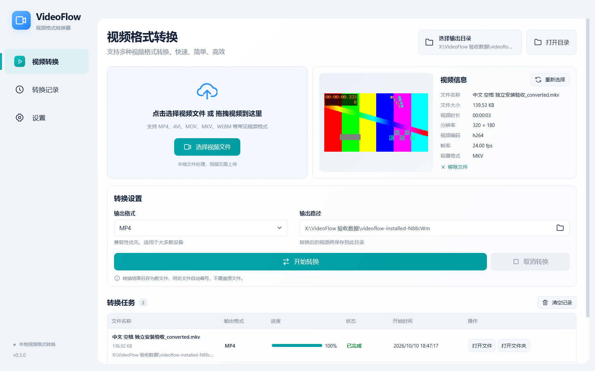

# VideoFlow 视频格式转换器

VideoFlow 是简体中文 Windows 桌面视频转换工具。视频在本机处理，无需上传或登录。支持 MP4、AVI、MOV、MKV、WEBM 的导入与转换，自动显示视频信息和缩略图，提供真实进度、取消和结果打开功能。

当前版本 **0.3.0**。已生成并实测 Windows x64 安装程序；当前用于本地验收。**公开分发前仍需补齐 FFmpeg 对应源码交付材料和项目许可证决策**，详见 [发布检查](docs/release_readiness.md)。安装包尚未代码签名。

## 安装与使用

1. 在 Windows x64 上运行 `VideoFlow-Setup-0.3.0-x64.exe`，按安装向导选择位置。
2. 从桌面或开始菜单的 **VideoFlow** 快捷方式启动。
3. 点击“选择视频文件”或拖入一个视频，等待信息和预览生成。
4. 选择输出格式、输出文件夹，再点击“开始转换”。
5. 完成后使用任务行的“打开文件”或“打开文件夹”。转换中可以取消；关闭窗口时可选择继续转换或取消并退出。

本机已生成的安装包位于 `release/0.3.0/`，该目录不提交 Git；目前没有公开下载地址，也尚未发布 GitHub Release。获得源码后可按下文自行构建用于本地验证。最终用户**无需安装 Node.js、Python 或 FFmpeg，无需运行 npm、配置环境变量或启动服务器**。安装包带有两个视频处理引擎及现有许可证材料，但公开再分发材料仍有缺口。可通过 Windows“已安装的应用”卸载。

界面保持浅色、青绿色按钮和固定侧栏；右侧按窗口高度滚动。较窄窗口中任务表可横向滚动。长文件名/路径显示省略号，鼠标悬停可查看完整内容，输出路径框可选择复制。



[查看 920×640 窗口中的任务与结果操作](screenshots/installed-920.png)。截图来自真实安装验收，测试图案由 FFmpeg 生成；路径是测试输出目录，不是应用固定依赖，也不是应用预置任务。两张图展示核心转换流程和窗口适配，尚未覆盖运行中/失败状态、记录页和设置页的独立截图。

## 功能和使用边界

- 显示文件名、大小、时长、分辨率、视频编码、帧率和易读容器名称；无法获得的信息标为“未知”。
- 自动提取真实缩略图，极短视频从首帧提取；缩略图失败有占位，不阻止转换。
- 同时执行一个任务，记录等待中、转换中、已完成、失败和已取消状态。未知时长显示不确定进度。
- 结果另存为 `原文件名_converted.格式`，重名自动追加编号；同格式也重新编码，不覆盖源文件或已有结果。
- 失败/取消时清理本次任务临时文件；正常关闭前等待视频子进程退出。
- 记录、输出目录选择和格式选择只保留在本次运行期间。清空记录不会删除视频。
- 没有批量队列、高级质量/分辨率设置、历史数据库或网络后端。
- 取消选择保留原视频。文件损坏、不可写目录、源文件已移动等情况有中文提示。
- 默认播放器能否播放取决于其容器/编码支持；转换结果经过 FFprobe 校验。不能承诺所有特殊素材、播放器或损坏文件兼容。

| 输出格式 | 默认视频编码 | 默认音频编码 |
| --- | --- | --- |
| MP4 / MOV / MKV | H.264 / libx264，CRF 23 | AAC，192 kbps |
| AVI | MPEG-4 Part 2，q=4 | MP3，192 kbps |
| WEBM | VP9，CRF 32 | Opus，192 kbps |

使用首个非封面视频流、可选首个音频流；不复制字幕/数据流。音频转换为 48 kHz 双声道，画面奇数宽高补齐为偶数，采用 yuv420p。

## 开发启动

开发环境要求 Windows x64、Node.js ≥22.12（本次使用 24.18.0）、npm（11.16.0）、Git。当前锁定 Electron 44.7.0、Vue 3.5.43、Vite 8.3.4、Vue 插件 6.0.10、Tailwind CSS 4.3.3、electron-builder 26.15.3、Playwright 1.64.0，没有新增阶段三运行时依赖。

在项目目录运行：

使用 Git 克隆源码时会自带 `.git`。若获得的是不含 Git 元数据的源码 ZIP，请先在解压后的项目目录执行 `git init`（仅初始化本地元数据，不创建远程仓库）：本轮实测 Tailwind 自动扫描在无 Git 元数据时生成更多无用 CSS，具有 `.git` 的干净副本与现有正式构建的 HTML/CSS/JS 一致。

```powershell
npm.cmd ci
npx.cmd --no-install install-electron
# 按 tools/ffmpeg/README.md 准备本地 FFmpeg / FFprobe
npm.cmd run dev
```

使用 `npm.cmd` 可避免 PowerShell 执行策略拦截 `npm.ps1`，不必修改系统策略。开发脚本启动 Vite `127.0.0.1:5173` 和真实 Electron 窗口，窗口关闭后退出；端口被占用时明确报错。Vue/CSS 支持热更新，修改 Electron/Preload 后重启。

如网络无法连接官方下载地址，可按需使用镜像，不修改全局 npm 配置：

```powershell
npm.cmd ci --registry=https://registry.npmmirror.com
$env:ELECTRON_MIRROR='https://npmmirror.com/mirrors/electron/'
npx.cmd --no-install install-electron
```

生产页面开发检查：`npm.cmd run build` 后运行 `npm.cmd start`。应用加载本地 HTML；单独用浏览器访问不具备桌面功能。

## 引擎与打包

复现 0.3.0 请使用 [Gyan 9.0.2 固定版本 ZIP](https://www.gyan.dev/ffmpeg/builds/packages/ffmpeg-9.0.2-essentials_build.zip)，不要用会滚动更新的 latest 下载替代。校验 ZIP 的 SHA256 为 `60f467265b1e312373dbcd92200c2618a74850f98d3d078e94296bb3fa2047ba` 后解压；开发引擎放入 `tools/ffmpeg/bin/ffmpeg.exe`、`ffprobe.exe`，将该包 LICENSE 保存为 `tools/ffmpeg/LICENSE`、README.txt 保存为 `third-party/FFmpeg-vendor-README.txt`。操作示例见 [引擎配置](tools/ffmpeg/README.md)。可执行文件不提交 Git，源码使用者需按说明准备；仅设置开发环境变量不足以准备打包资源。

开发环境支持显式引擎环境变量、resources、项目 tools、PATH 顺序查找；**安装版仅使用自身 `resources/ffmpeg/`，不读取开发目录、不回退全局 PATH，也不使用引擎路径环境变量**。设置页显示实际引擎版本和路径。

```powershell
npm.cmd run build
npm.cmd test
npm.cmd run dist:win
```

`dist:win` 自动检查本地引擎、生成 SHA256 清单与第三方许可证目录，然后生成 Windows x64 NSIS 安装程序。输出：

```text
release/0.3.0/VideoFlow-Setup-0.3.0-x64.exe
release/0.3.0/VideoFlow-Setup-0.3.0-x64.exe.blockmap
release/0.3.0/win-unpacked/VideoFlow.exe
```

`npm.cmd run pack` 仅生成解包目录，不能单独移动其中的 EXE。打包采用本地 Electron x64 二进制和项目盘 `.cache/electron-builder` 缓存。本机首次阶段一下载曾超时，可选设置：

```powershell
$env:ELECTRON_BUILDER_BINARIES_MIRROR='https://npmmirror.com/mirrors/electron-builder-binaries/'
npm.cmd run dist:win
```

构建输出目录在 `electron-builder.yml` 显式指定；以后升级版本时同步调整该目录，先检查已有产物再构建。旧版 `release/VideoFlow-Setup-0.1.0.exe` 保留，不是本次交付。打包成功不等于公开分发许可已齐备。

## 验证方法

`npm.cmd test` 在构建后执行 11 项源码回归：真实五格式转换及反向 MP4、完整解码、短视频、损坏文件、未知时长、重名、取消、权限拒绝、IPC、页面与窗口布局等。测试用合法 FFmpeg lavfi 样本，样本不是应用预置业务数据。

先实际运行安装程序，再执行独立安装验收：

```powershell
$env:VIDEOFLOW_TEST_EXE=Join-Path $env:LOCALAPPDATA 'Programs\VideoFlow 验收 0.3.0\VideoFlow.exe'
# 改为实际安装位置，必须在源码目录外
npm.cmd run test:installed
```

安装测试用真实 Windows 文件对话框和内置引擎，缩减应用 PATH，校验安装文件哈希，转换 MP4→MKV→MP4，检测取消/关闭清理并重新启动。会真实调用默认播放器与资源管理器；不要在另一个窗口同时转换任务。输出目录选择和关闭确认的选择结果在测试中自动提供，未伪造媒体结果。

截图保存于 `screenshots/`，本机证据保存于忽略提交的 `.cache/installed-acceptance.json`。源码测试生成目录为 `.cache/phase2-test-*`；安装测试默认在系统临时目录生成独立测试目录，可用 `VIDEOFLOW_ACCEPTANCE_ROOT` 指定测试根目录。完整结果、人工反馈和未验证项见 [测试报告](docs/test_report.md)。

## 工程结构

```text
electron/main.cjs, preload.cjs    桌面窗口、系统操作、受限 IPC
electron/media/                  引擎定位、子进程、编码参数、媒体任务
src/components/, views/          沿用的中文界面和页面
src/composables/useDesktop.js    桌面状态与订阅管理
src/format.js, style.css         格式显示和样式
build/                          应用图标
scripts/                        开发启动、图标生成、发布检查、构建、原生验收辅助
tests/                          源码回归和独立安装验收
third-party/                    引擎清单、构建参数、原始通知与许可证
tools/ffmpeg/README.md           开发引擎准备说明
docs/                           开发日志、测试报告、发布检查
screenshots/installed-*.png      安装版真实界面截图
electron-builder.yml            x64 / 中文 NSIS 配置
```

需求以根目录 `requirements.md` 为唯一依据，原始 UI 参考图保持原样。主进程执行所有系统命令/文件操作，参数数组且禁用 shell；启用 contextIsolation/sandbox、关闭 nodeIntegration、校验 IPC 主窗口/主框架来源。没有通用命令执行或任意路径打开接口，没有独立 HTTP 服务。

`.gitignore` 排除依赖、构建、缓存、测试输出、用户视频目录和私密配置；保留可复现源码、锁文件、必要通知和经检查的安装截图。

会话结束总结见 [AI 开发总结](docs/ai_development_summary.md)，最终通过项、阻塞项及提交清单见 [交付审查](docs/final_delivery_check.md)。项目自有代码尚未选择开源许可证，不将第三方 GPL 文本误作整个 VideoFlow 的许可声明。源码仓库提交与安装包公开分发的结论分别列出。
